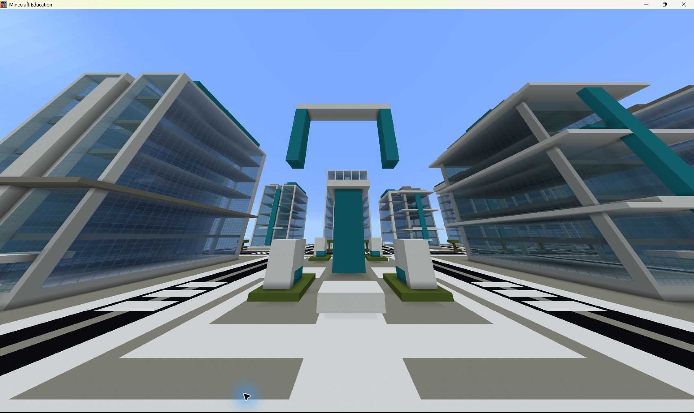
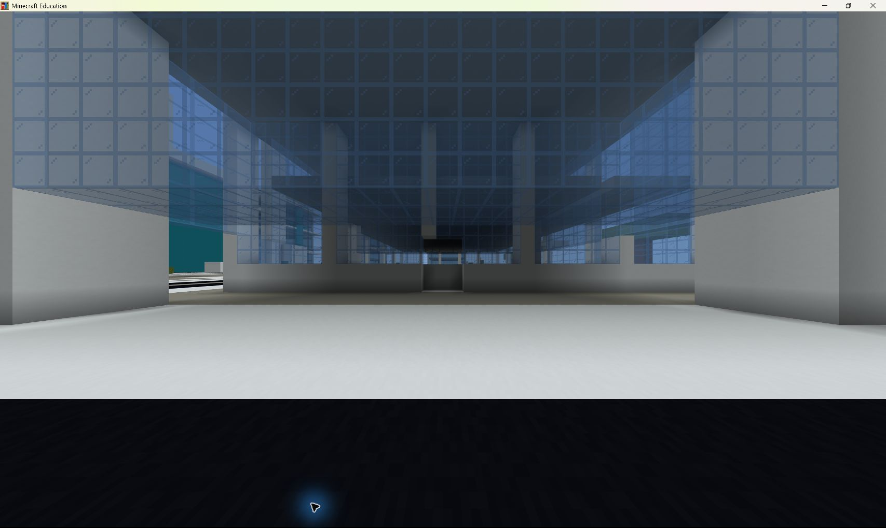
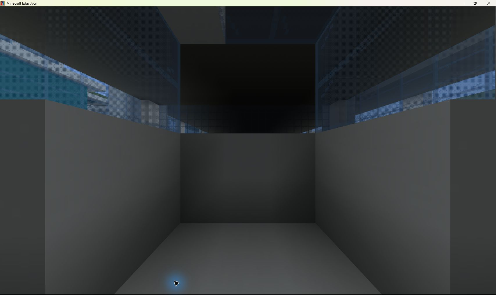
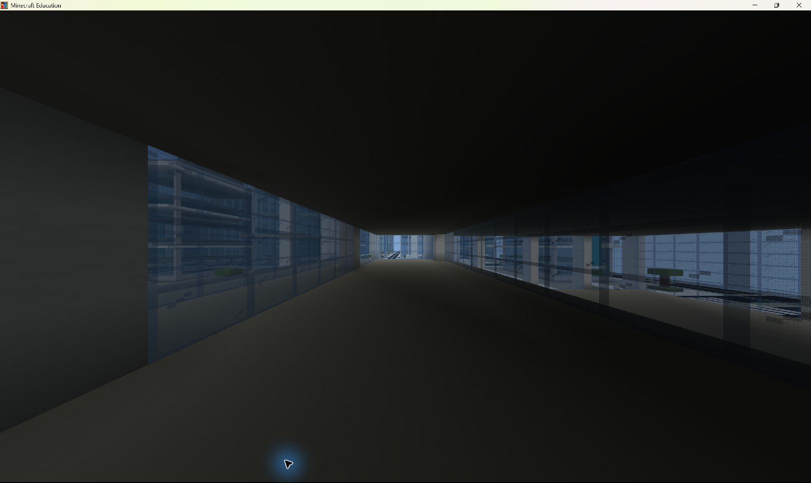
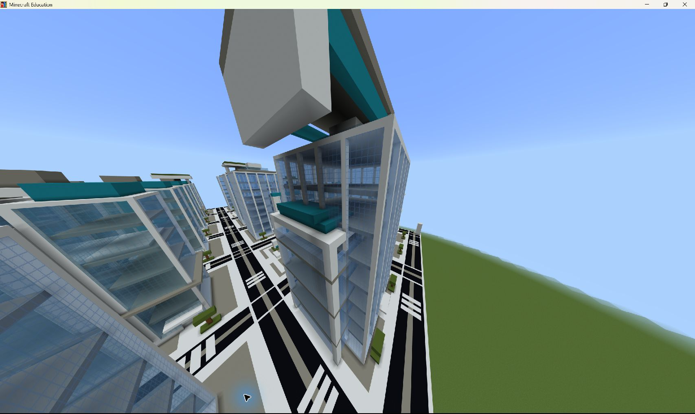
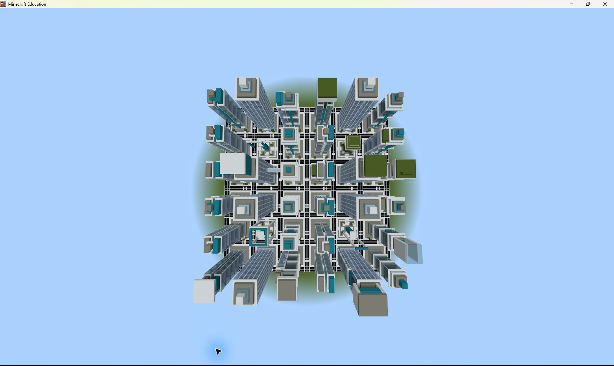
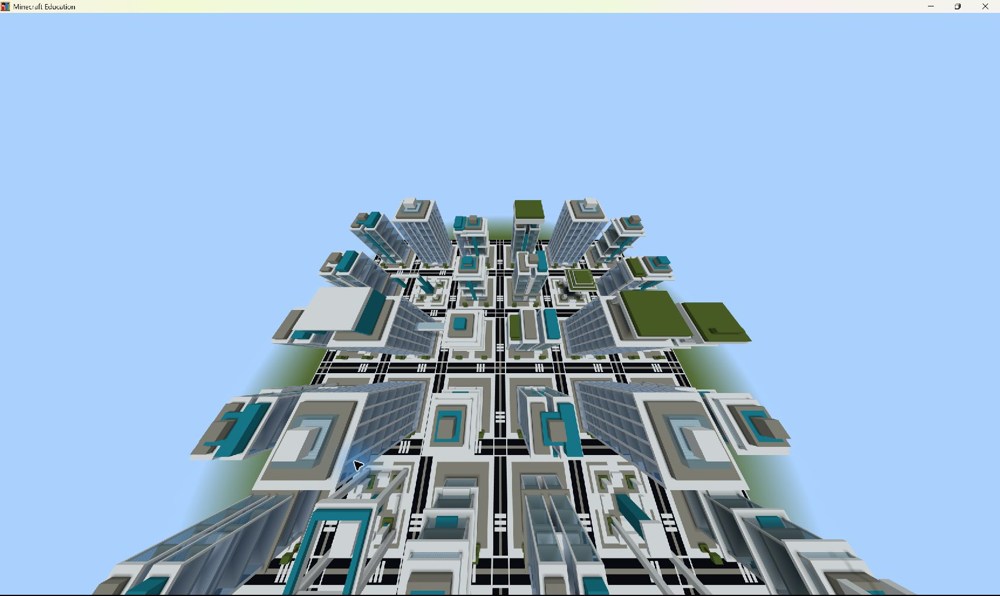

# G4-C4 実機景観QA — 未完成／景観・実用性は不合格

観察日: 2026-10-20（日本時間）。対象: Draft PR [#29](https://github.com/ryomashibaba/makecode-limitlab/pull/29)、`dev/g4c-c1-a2-a3-building-massing`、施工ソースHEAD `db410635108fce3805ddaac5b9392f111d3b216f`。本レポートのブランチは `codex/g4c4-landscape-qa`。

**既存の施工完走は維持するが、景観完成・利用可能な建物としては承認しない。** 施工CSVの全15工程PASS、563 Fill / 49 Clone / 395点検査と、美術・入口・階間移動の合格は別である。今回の成果は実機写真と品質診断の追加。建築形状の修正版は実装しておらず、修正版の実機PASSも存在しない。

## 実機で行ったことと証拠の限界

- OMEN WindowsのMinecraft Educationで、すでに開かれていた保存済みテストワールドを継続観察した。新しい施工コマンド、Fill、Clone、ブロック破壊・設置、ラッチの準備・再利用は行っていない。
- ゲーム内履歴のG4C4完走表示、既存CSVの厳格解析、8翼の位置・色・形状を照合した。ワールド設定に表示された名前は `LimitLab_G4C1R1_DISPOSABLE_202`。古い名称を変更していない。このワールド全体がG4C4専用の新規ワールドだったことまでは今回立証していない。
- 移動には観察用 `/tp` を使用した。撮影座標と形状の一致から施工原点を `(3016,96,1024)` と推定。既存CSVには原点がなく、CSVから取得した値ではない。
- 一部の内部写真はテレポートで直接入って撮影した。**入口を歩いて通過した証拠には数えない。** 通常移動キーを試したが、画像から継続歩行・衝突判定の成功を確定できなかった。全8翼の「外部→室内→上階→外部」の実機歩行試験は未完了。
- 撮影用にHUDを隠し、終了時に戻した。ウィンドウは最大化した。設定値・ワールド名は変更していない。観察後は「セーブして終了」でワールドを閉じた。通常の保存によりカメラ位置・サムネイルは更新されているが、修正版を既存建築へ施工する上書きはしていない。
- 画像はMinecraftの実画面。レンダリング画像・画像生成・ボクセル模擬図ではない。共有画像にはチャット履歴やアカウント表示を含めていない。旧CSV・ZIP・ラッチ・個人情報はPRに含めない。

## 重大な指摘

### P1: 研究地区の中央フレームが浮いている（実機で確認）

逆U字フレームの左右の脚が空中で終わっており、下の公共モニュメントと接続していない。地上まで柱がある都心のゲートとは異なる。Minecraftでブロックが落下しないことは、建築表現上の支持成立の根拠にならない。

対応する模擬施工では相対 `(264,265)` の脚の開始がY29、直下Y11..28に18ブロック連続のAIRがある。これは実機写真とは別の裏付けであり、構造力学の解析ではない。

### P1: AIR開口は本体への実用的な入口を証明していない

A1東側の地上開口を外側と内側から撮影した。開口内の奥には白い腰壁と上部のガラスが見え、平坦な通路として本体内部へ抜けるようには見えない。既存の本体ポディウムと、追加の小さなAIR切削が整合していない疑いが強い。

判定は「本体への通常歩行は未確認／実用入口として未承認」。**全8翼が外部から全く入れない、とは断定しない。** 下記の模擬診断では8翼ともAIR切削点までは道路から到達できた。小さな外側の窪みに入れることと、主室を使えることは異なる。

### P1: 階床はあるが、上階へ上がる経路がない（ソース・模擬診断）

既存の試験は床上の1点や柱の存在を見るだけで、階段・はしご・床の穴・入口からの到達性を検査していない。施工ソースには側翼の階間経路の生成がない。本体と側翼の床高さも一致せず、既存の床やガラスを残したまま別の床を追加している。

実機のA1内部では、低い天井とガラスによる区切りを撮影できた。実機写真だけで全翼・全階の到達不能を立証したわけではない。模擬診断では8翼・計20枚の中間階床に立てる空間はあるが、道路からそこへ至る経路は0だった。

### P2: 屋根の大きさと支持の見せ方が不自然

都心の長い屋根冠は塔や側翼に比べて大きく、遠景では板の張り出しが主役になる。文化・緑化地区でも、薄い大面積の屋根を上に置いた表現が目立つ。側翼自身の段屋根は厚みがあるものの、既存の巨大冠や本体の床との重なりを解決していない。

模擬施工では、都心の冠の東脚の一例 `(118,26)` についてY50..68がAIR、脚がY69から始まる。冠自体はほかの部分でつながっている可能性があるため、「屋根全体が孤立」とはしないが、この脚を下まで連続する支持柱と呼べない。

## 32棟と4地区の比較

| 地区 | 実機で見えた差 | 厳しい評価 |
| --- | --- | --- |
| A 都心 | 巨大な長い冠、中央ゲート、2翼 | 冠とゲートの寸法が支配的。建物本体の街並みはほかの地区と似る |
| B 文化 | 高い開放フレーム、上部キャノピー、2翼 | 文化施設というより屋上装飾と門。低層の展示・集会施設としての利用空間が不足 |
| C 緑化 | 緑の屋根、段状の中央冠、2翼 | 屋上色は識別しやすいが、住棟・生活動線・庭への経路が示されていない |
| D 研究 | シアンのフィン・橋・冠、2翼 | 中央フレームが浮遊。研究棟の内部機能は未確認。側翼は他地区と同じ構法に見える |

共通する塔の3系統と規則的な配置が全地区に反復し、増築8翼も同じ15×28の直方体・4本柱・段屋根を使っている。色と高さの差はあるが、展示ホール、住宅、研究室、業務ポディウムという用途の違いが建物本体の形状から十分に伝わらない。異なるボクセル数の署名が4つあることは、美術的に異なる街並みの証明ではない。

道路の白黒パターン、横断帯、街区間の連続は俯瞰と接写で確認した。全道路を実機で踏破したわけではなく、障害物ゼロの実機保証は行わない。既存の道路不変・サンプル障害物検査は模擬試験の結果として扱う。

## 8翼の撮影台帳

座標は推定原点を加算した観察用カメラ位置。yaw=55、pitch=18の外観写真は同じ方向・ほぼ同じ相対位置で撮影したが、隣接地区も写るため厳密な同一画角の地区比較ではない。すべてテレポートでの撮影であり、歩行PASSの台帳ではない。

| 翼 | 地区内原点 x/z | h | 外観カメラ x/y/z | 写真 |
| --- | --- | --- | --- | --- |
| A1 | 104 / 25 | 48 | 3144 / 155 / 1038 | [全形・冠・接合](evidence/g4c4-landscape/15-A1-wing-and-oversized-crown.png) |
| A2 | 44 / 145 | 38 | 3084 / 145 / 1158 | [全形・段屋根・接合](evidence/g4c4-landscape/08-A2-wing-roof-junction.png) |
| B1 | 44 / 24 | 46 | 3264 / 153 / 1037 | [全形・キャノピー](evidence/g4c4-landscape/09-B1-wing-and-canopy.png) |
| B2 | 164 / 144 | 38 | 3384 / 145 / 1157 | [全形・段屋根・接合](evidence/g4c4-landscape/10-B2-wing-roof-junction.png) |
| C1 | 44 / 82 | 46 | 3084 / 153 / 1275 | [全形・緑屋根](evidence/g4c4-landscape/11-C1-wing-roof-junction.png) |
| C2 | 164 / 24 | 38 | 3204 / 145 / 1217 | [全形・緑屋根・接合](evidence/g4c4-landscape/12-C2-wing-roof-junction.png) |
| D1 | 44 / 144 | 49 | 3264 / 156 / 1337 | [全形・段屋根・接合](evidence/g4c4-landscape/13-D1-wing-roof-junction.png) |
| D2 | 164 / 84 | 42 | 3384 / 149 / 1277 | [全形・段屋根・接合](evidence/g4c4-landscape/14-D2-wing-roof-junction.png) |

A1地上外側は `(3138,98,1062)` yaw90/pitch0、開口内は `(3130.5,98,1062.5)` yaw90/pitch0、中間階床は `(3125.5,111,1062.5)` yaw0/pitch0。中間階床・入口の詳細実機写真はA1のみ。ほか7翼の内部通常歩行・全階撮影は未実施。

## 中央公共施設の写真

撮影高さは原点+10で、全て地上歩行の撮影とは呼ばない。A/B/C/Dのカメラは `(3112,106,1090)`、`(3292,106,1090)`、`(3112,106,1270)`、`(3292,106,1270)`。

| 地区 | 写真 | 評価 |
| --- | --- | --- |
| A | [ゲートと中央モニュメント](evidence/g4c4-landscape/17-A-civic-ground.png) | 脚が地上へ延びるが、利用施設より記念門に見える |
| B | [開放フレーム](evidence/g4c4-landscape/18-B-civic-frame.png) | 支持のある空間だが、屋内ホールとしての整備が不足 |
| C | [大きな張り出し冠](evidence/g4c4-landscape/19-C-civic-overhang.png) | 生活利用や上部への経路は未確認 |
| D | [浮遊フレーム](evidence/g4c4-landscape/20-D-civic-floating-frame.png) | 支持が途切れる明確な景観欠陥 |

## 独立した模擬診断とCI

`tools/audit_g4c4_access.js` はMinecraftへ接続しない読取専用診断。元の施工ソースGit blob `417fc20aedec61deb99e70e0b8c6b70751314453` を固定し、既存の全域ボクセル施工を再利用する。

道路上を開始点として、足元に固体、足・頭の2セルがAIR、水平4方向・昇降最大1段・頭上空間あり、という移動モデルで探索する。飛行・テレポートを使わないが、Minecraftの実際の連続衝突・ジャンプ物理・プレイヤー幅の再現ではない。はしご・水・扉などはこのソースの材質集合に存在せず、このモデルにも実装していない。

結果は [診断JSON](G4C4_ACCESS_DIAGNOSTIC.json) に保存。8翼のAIR点は8/8道路到達、追加階床は20/20で立てるセルが存在する一方、道路到達セルは全て0。結果名は `MODEL_UPPER_FLOORS_UNREACHABLE`。既存の13/13試験成功と、この追加診断の欠陥検出は両立する。

新しいCI名は **Reproduce G4C4 known access failures (NOT city quality approval)**。CI成功は既知の欠陥を記録通り再現した意味であり、修正版の施工承認・実機歩行PASS・景観承認ではない。

## 性能比較

元の実機CSVは51行、全15工程PASS、`FAST_COMPLETED_SAMPLED_NOT_EXACT` と厳格解析された。今回の観察で新しい施工はしていない。

| 版 | Fill | Clone | 検査点 | 今回の扱い |
| --- | ---: | ---: | ---: | --- |
| A1-R1 | 386 | 49 | 361 | 既存文書の基準値 |
| A2-A2 / G4C3 | 447 | 49 | 383 | 既存文書の基準値 |
| A2-A3 / G4C4 | 563 | 49 | 395 | 既存実機CSVと今回の模擬施工で一致 |
| 今回のQA成果 | 追加施工0 | 追加施工0 | 追加実機ブロック検査0 | 写真・読取診断のみ |

G4C3比でFillは116増（約26.0%）、Cloneは同数、検査点は12増。模擬施工の最大Fillは4,608、最大Cloneは194,400ブロック。CSVに開始・終了時刻がなく、今回も再施工していないため、施工秒数・速度・FPS・メモリ量の改善／悪化は測定不能。コマンド数の増加を実時間増加率に置き換えない。

## 保全・終了と未解決事項

- 対象の既存CSVとUSEDラッチのSHA-256を観察中と終了後で照合し、同一だった。旧ZIP、ほかのCSV、使用済みラッチには書き込みを行っていない。
- 既存の実機PASS版ソース・ツール・試験は変更していない。独立ブランチには診断、写真、日本語レポート、診断再現CIだけを追加する。元の作業ツリーにあった未追跡ファイルも保持した。
- 建物形状の修正版、新規のテストワールド、新規施工ラッチは今回作っていない。新しい実機施工・再試行・修正版実機PASSはない。
- 未解決: 全8翼の通常歩行、室内からの退避、本体との段差処理、全20階床への階間移動、屋上到達、各室の明るさ・用途、4地区の本体形状の差別化、巨大屋根の縮小と支持再設計、D中央の浮遊フレーム。
- 次の構造改修は、(1)本体と側翼の重複領域を整理し床高さを揃える、(2)歩道から入る連続した入口と主室への経路を確保する、(3)床開口を伴う階段・踊り場を生成する、(4)浮遊構造を地上または主棟へ接合するか除去する、(5)用途ごとの本体・低層部を作り分ける、の順に行う。小さなAIR点の追加や薄板屋根の増設で完成扱いにしない。
- 修正版を施工する場合は、旧版のソース・CSV・ZIP・USEDを保存したまま新しい版・出力先・新規ラッチを用意し、CI後に別の破棄可能ワールドで一度だけ試験する。今回の保存ワールドへの修正版施工はしない。
- Computer Useによる観察は終了し、Minecraftはワールド一覧に戻した。この一時的なWork Local利用の後、通常のChat主体の開発へ戻す。継続監視や自動施工は設定していない。
